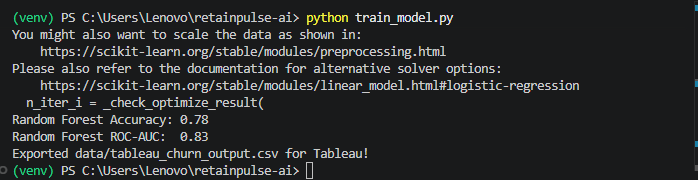

# RetainPulse AI — Subscription Revenue Diagnostics & Churn Predictor

An end-to-end data engineering and machine learning pipeline that ingests subscription customer logs, performs SQL-based ETL feature engineering, predicts churn probability, and exports risk segments for executive BI dashboards.

## Architecture
`Raw Customer Logs (CSV)` ➔ `Pandas Data Cleaning` ➔ `SQLite Warehouse (retainpulse.db)` ➔ `SQL Feature Extraction` ➔ `Scikit-Learn Random Forest Classifier` ➔ `BI Risk Segmentation Export`

## Key Results (MVP)
- **Dataset:** 7,032 active customer records processed via SQLite ETL pipeline
- **Model Performance:** **0.83 ROC-AUC** | **78% Accuracy** (Random Forest Classifier)
- **Output:** Automated customer segmentation (`Low Risk`, `Medium Risk`, `High Risk`) exported to `data/tableau_churn_output.csv`

## Demo Output

## Tech Stack
- **Language:** Python
- **Data & SQL:** Pandas, SQLite3
- **Machine Learning:** Scikit-Learn (Random Forest, Logistic Regression)

## Roadmap (Next Upgrade)
- [ ] Hyperparameter tuning & cross-validation comparison table (Logistic Regression vs. Random Forest vs. Gradient Boosting)
- [ ] SHAP feature importance explanations for top churn drivers
- [ ] Automated pytest data-validation suite